<div align="center">

# 北邮 801 通信原理 · 真题库

**把北京邮电大学「801 通信原理」历年真题，做成一份能刷、能模考、能背、能查、能打印的结构化题库。**

题干逐字转录 · 答案三路对账 · 框图按原卷重绘 · 数据只留在你本地浏览器

[](https://ygxiuming.github.io/BUPT-801-Tiku/)
[](https://github.com/ygxiuming/BUPT-801-Tiku)
[](#请作者喝杯咖啡)

[](https://github.com/ygxiuming/BUPT-801-Tiku/actions/workflows/ci.yml)
[](https://github.com/ygxiuming/BUPT-801-Tiku/actions/workflows/pages.yml)
[](https://github.com/ygxiuming/BUPT-801-Tiku/releases)
[](./LICENSE)

**[立即在线刷题](https://ygxiuming.github.io/BUPT-801-Tiku/)** ｜ 免登录 · 免安装 · 打开就能用

</div>

> **觉得有用？先点个 Star 再走。**
> Star 不会让题目变简单，但会让更多人找到这份题库，也会让作者在下一个重绘框图的凌晨多一点动力。
> 想请作者续命，文末有[咖啡入口](#请作者喝杯咖啡)；不想花钱，[Star](https://github.com/ygxiuming/BUPT-801-Tiku) 同样管用。

<p align="center">
  <a href="https://ygxiuming.github.io/BUPT-801-Tiku/">
    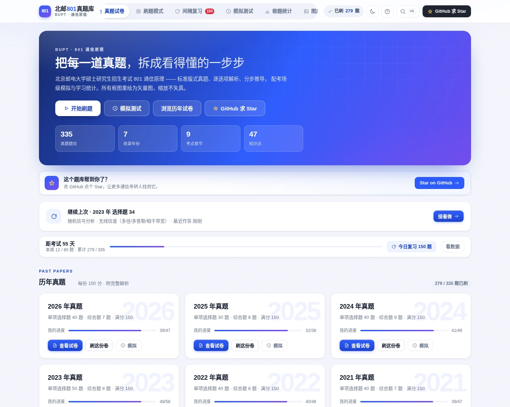
  </a>
</p>
<p align="center"><sub>首页：逐年进度、继续上次、考点覆盖，以及顶栏和 Hero 区的 Star 入口</sub></p>

---

## 目录

- [这是什么](#这是什么)
- [先看几张图](#先看几张图)
- [图不是截图，是按原卷重画的](#图不是截图是按原卷重画的)
- [已收录](#已收录)
- [快速开始](#快速开始)
- [部署](#部署)
- [数据是怎么进来的](#数据是怎么进来的)
- [质量与验收](#质量与验收)
- [版本与发布](#版本与发布)
- [纠错与贡献](#纠错与贡献)
- [请作者喝杯咖啡](#请作者喝杯咖啡)
- [版权与免责](#版权与免责)

## 这是什么

一份**数据与界面分离**的题库工程：`data/` 是可读可 diff 的题源，`app/` 是纯前端的刷题站，`tools/` 负责把「抄错、算错、图错」挡在提交之前。没有后端也能跑，有后端则多一个「在线导出排版好的 PDF」。

| | 数量 |
|---|---|
| 收录年份 | **7 年**（2020 – 2026） |
| 选择题 | **280 空**（含共用选项组的整组选项表） |
| 综合题 | **55 道**（分步推导，不是只给结论） |
| 重绘框图 | **73 张** SVG（题图 + 解析配图） |
| 前端页面 | **8 个**（首页 / 试卷 / 刷题 / 模考 / 复习 / 统计 / 图库 / 编辑器） |

| 页面 | 能力 |
|---|---|
| **首页** `/` | 逐年进度、继续上次、考点覆盖、功能入口 |
| **试卷** `/paper/2025` | 统一版式真题 + 章节目录导航；解析可开关；打印 / 在线 PDF |
| **刷题** `/practice` | 按年份 / 题型 / 章节→知识点 / 易错点 / 收藏 / 笔记 / 未做 筛选；选择题点选即判 + **逐选项解析**；大题三档掌握度自评；逐题计时、题目笔记、题目深链 `?id=` |
| **模考** `/exam` | 倒计时 + 答题卡 + 标记存疑；交卷自动判分（综合题按满分/部分/0 分自评）；中断自动保存，刷新可续；交卷出**节奏分析**（每分耗时 vs 参考线） |
| **复习** `/review` | FSRS 简化模型排期，四档评分；到期队列 + 未来 14 天负荷预测 |
| **统计** `/stats` | 总/分章正确率、掌握度环形图、近 14 天活跃度、**考点热度矩阵（章 × 年）**、模考成绩趋势、错题本与收藏一键重练、学习计划与倒计时 |
| **图库** `/figures` | 73 张 SVG 按年份/题图/解析图分组，关键词搜索，点击全屏放大（滚轮缩放、拖拽、Esc 关闭） |
| **编辑器** `/editor` | 表单录入 + KaTeX 实时预览 + 结构校验，一键导出 `paper.js` / `answer.js` 片段 |

任意页面按 `Ctrl / ⌘ + K` 唤出全站搜索：题干、选项、解析、知识点、易错点标签、图名都能搜，↑↓ 挑选、回车直达。

**数据不出浏览器**：做题记录、笔记、复习排期、模考成绩、学习计划全部存 `localStorage`，可在统计页导出 JSON 备份、换设备粘贴恢复。

## 先看几张图

> 以下都是站点的真实截图，数据为本地演示记录。

### 刷题：点选即判，四个选项都讲清楚

选择题不会只丢一个字母给你。每个选项单独解释对/错在哪，答对答错都能看到完整推理。

<p align="center">
  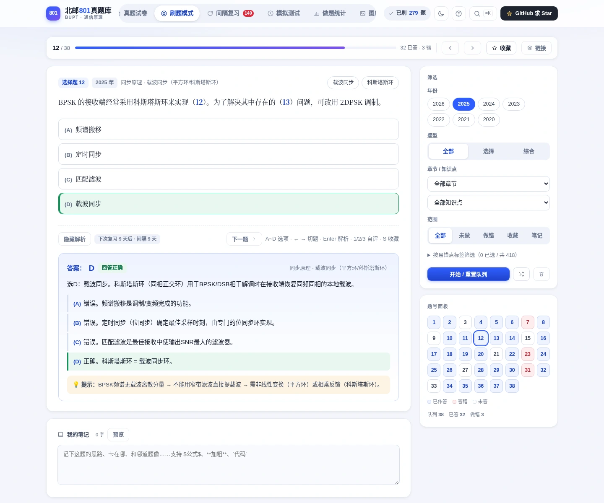
</p>
<p align="center"><sub>2025 年第 12 题 · 载波同步：选项逐条拆解 + 知识点标签 + 计时</sub></p>

### 综合题：不是只给答案，是一步步推导

55 道综合题全部按考试写法给出分步过程，关键公式用 KaTeX 排版，框图与解析配图联动。

<p align="center">
  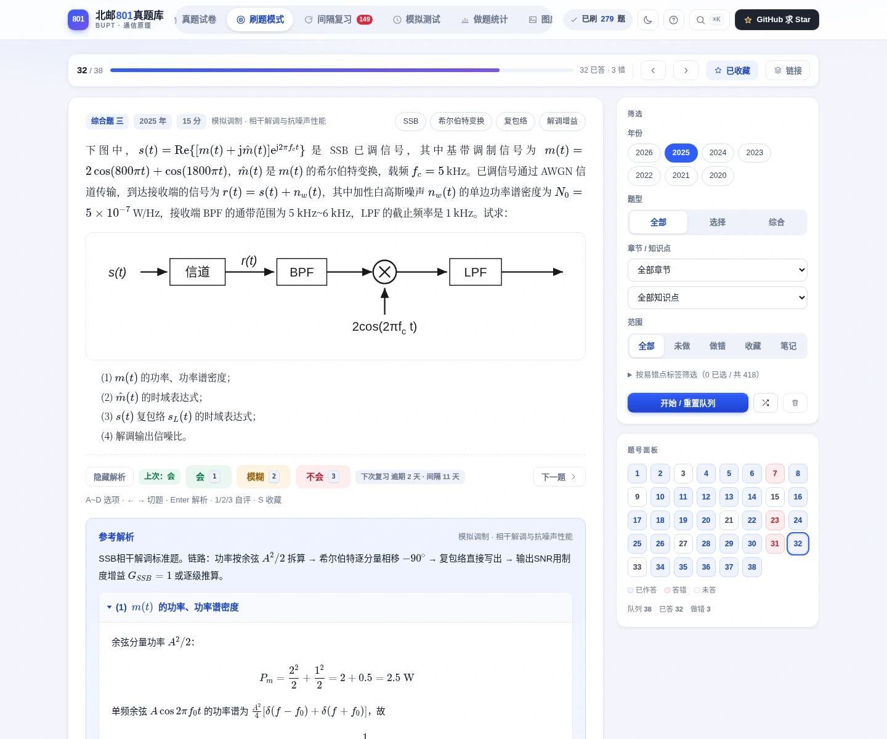
</p>
<p align="center"><sub>2025 年第三题 · SSB 相干解调与抗噪声性能</sub></p>

### 模考：倒计时、答题卡、交卷分析

还原考场节奏：限时作答、标记存疑、答题卡跳转；中断自动保存，刷新可续考。交卷后给选择题自动判分，综合题按三档自评。

<p align="center">
  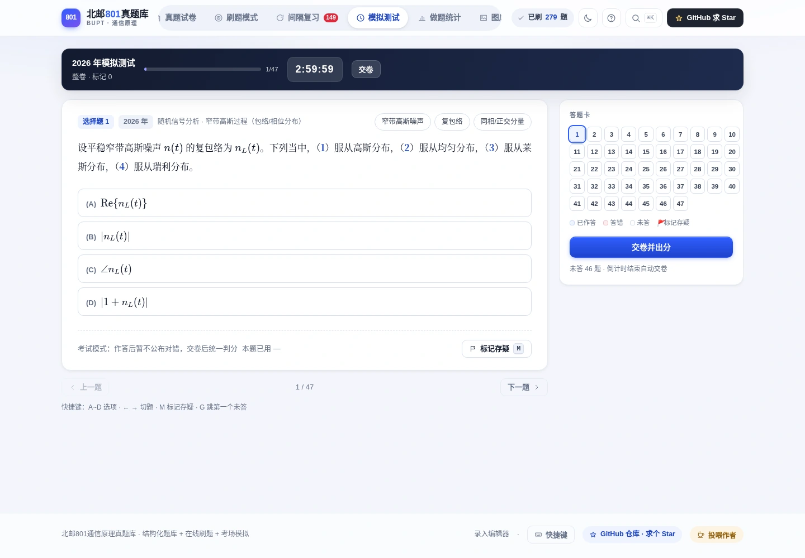
</p>
<p align="center"><sub>模拟测试进行中 · 剩余时间、作答进度、答题卡一屏可见</sub></p>

### 统计：知道自己弱在哪

不只统计「做了多少题」，还统计「哪一章、哪一年、哪类题在拖后腿」。考点热度矩阵直接按章 × 年铺开。

<p align="center">
  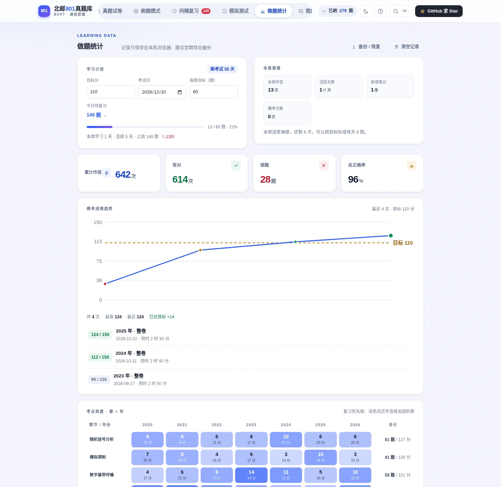
</p>
<p align="center"><sub>做题统计 · 学习计划、周报、分章正确率、掌握度与考点热度矩阵</sub></p>

### 图库与试卷：矢量图 + 可打印版式

73 张图全部按原卷重绘，放大不糊，浅色/深色主题都不违和；试卷页保留标准版式，可直接打印或在线导出 PDF。

<table>
  <tr>
    <td width="50%">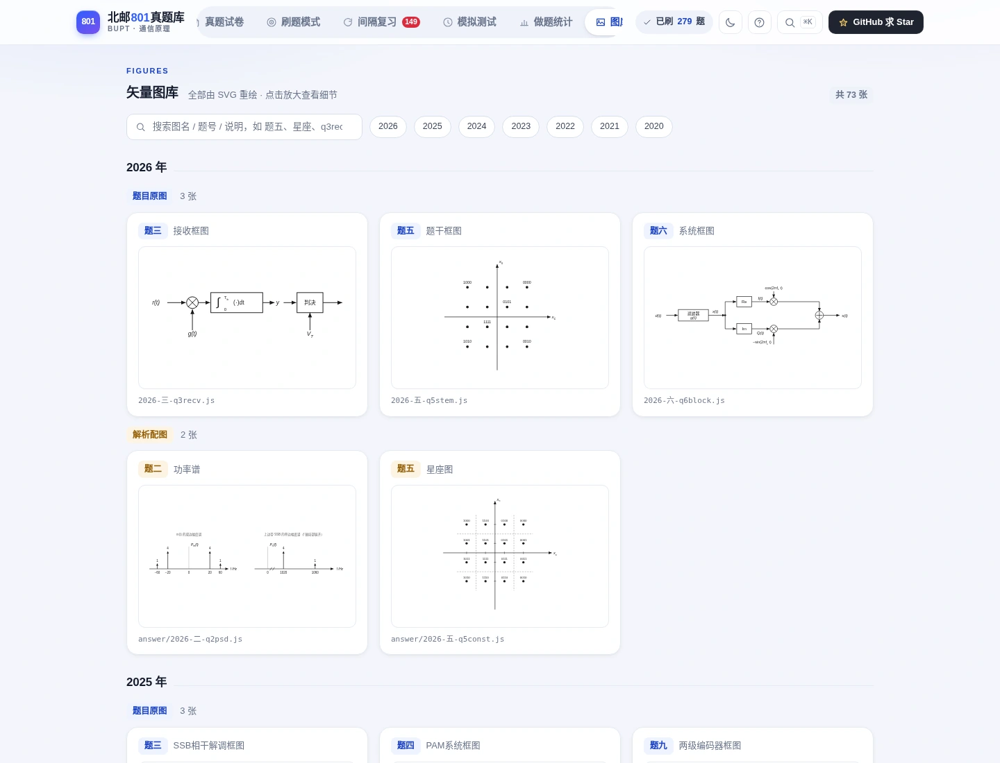</td>
    <td width="50%">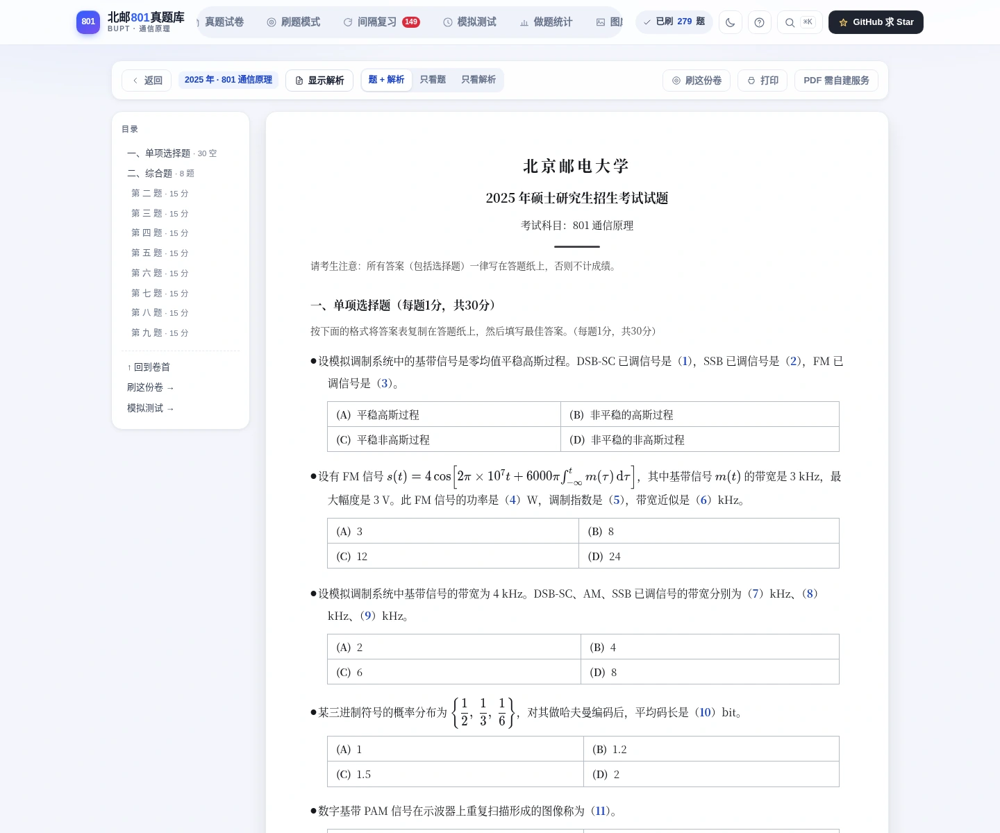</td>
  </tr>
  <tr>
    <td align="center"><sub>图库：按年份 / 题图 / 解析图分组，点击全屏放大</sub></td>
    <td align="center"><sub>试卷：标准版式 + 目录导航，打印 / PDF 两用</sub></td>
  </tr>
</table>

<p align="center">
  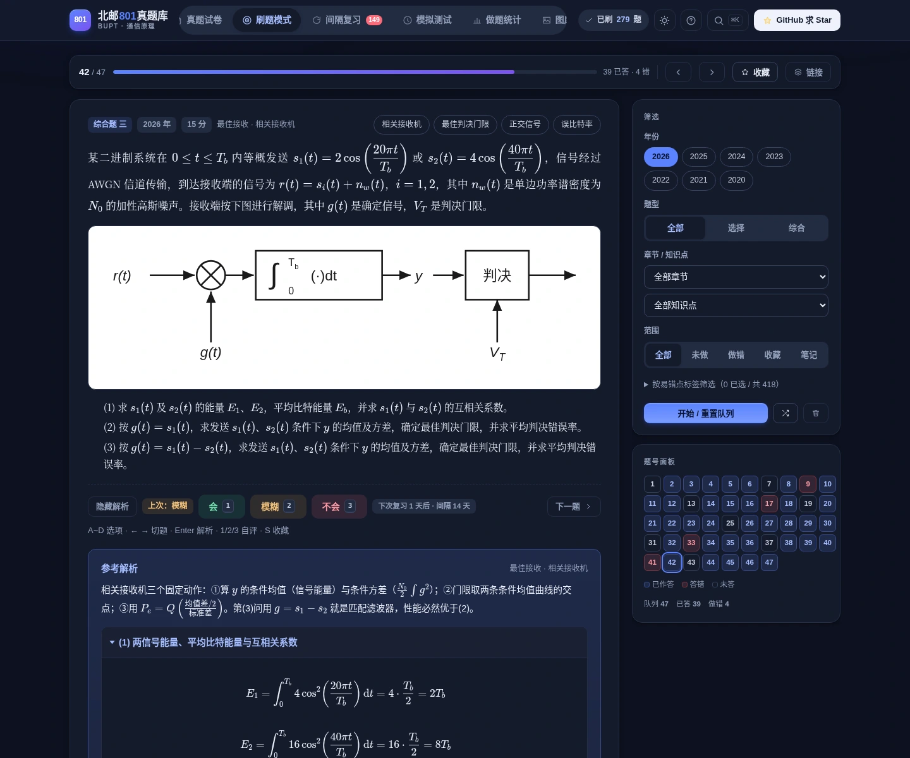
</p>
<p align="center"><sub>深色主题：同一套内容，夜里刷题不刺眼</sub></p>

## 图不是截图，是按原卷重画的

原始 PDF 里的框图和波形图放大就糊，且无法跟随浅色/深色主题。所以每张图都用 SVG 重绘：线型与色表统一、四边留白 18px、同类图互相参照比例，并有脚本检查 0 交叠。

<p align="center">
  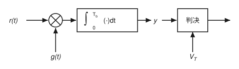
</p>
<p align="center"><sub>2026 · 第三题 · 接收机框图</sub></p>

<p align="center">
  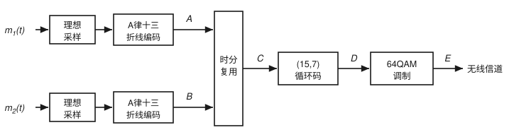
</p>
<p align="center"><sub>2023 · 第九题 · 系统总框图（当年最复杂的一张）</sub></p>

## 已收录

| 年份 | 选择题 | 综合题 | 分值 | 重绘 SVG | 备注 |
|---|---|---|---|---|---|
| 2026 | 40 空（17 个选项组） | 7 题 | 150 | 5 | 其中 11 组含多套选项 |
| 2025 | 30 题 | 8 题 | 150 | 11 | 逐选项详细解析 |
| 2024 | 40 空（20 题 × 2 空） | 9 题 | 150 | 10 | |
| 2023 | 50 空（28 个共用选项组） | 8 题 | 150 | 16 | 图最多的一年 |
| 2022 | 40 空 | 8 题 | **146** | 8 | 原卷标注就是 40 + 106，不是 150 |
| 2021 | 40 空 | 7 题 | 150 | 12 | |
| 2020 | 40 空 | 8 题 | 150 | 11 | 第八题为 (8,4) 线性分组码视角的卷积码 |

## 快速开始

```bash
# 1. 前端（Vue 3 + Vite）
cd app && npm install && npm run dev      # http://localhost:5173

# 2. 可选：带在线 PDF 的服务端（先构建前端，再起 Node）
cd app && npm run build
cd ../server && npm install && npm start  # http://127.0.0.1:3000
```

开发模式下 Vite 把 `/api` 代理到本地 3000 端口，所以只跑前端也能用刷题全部功能，只是「在线 PDF」按钮会自动隐藏。

> 装依赖时注意：`npm run build` 会执行 `npm run sync`，从 `server/node_modules/katex` 取 KaTeX 静态资源，所以**先装 server 的依赖**再构建前端。

## 部署

<p align="center">
  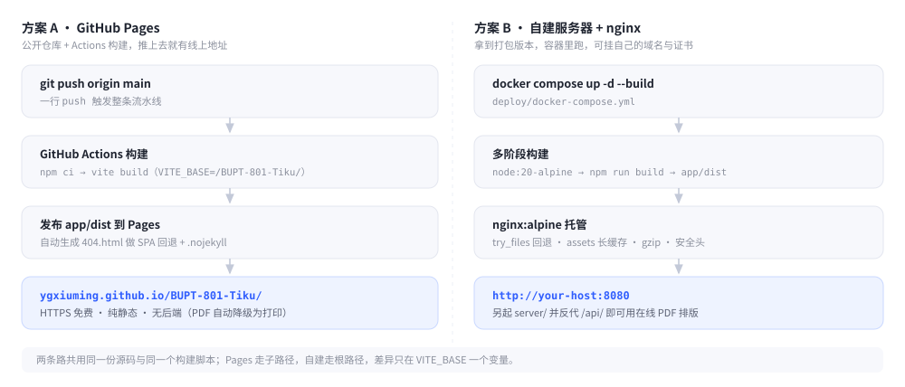
</p>

### 方案 A · GitHub Pages（本仓库正在用）

推到 `main` 就自动构建并发布，配置在 [`.github/workflows/pages.yml`](.github/workflows/pages.yml)：

```bash
git push origin main
# → Actions 构建 → 部署 app/dist → https://ygxiuming.github.io/BUPT-801-Tiku/
```

两个容易踩的点已经处理好：站点在**子路径**下，构建时注入 `VITE_BASE=/BUPT-801-Tiku/`，并把 `data/`、`vendor/` 这些 public 资源的绝对路径一并改写；vue-router 用 `history` 模式，所以额外生成了 `404.html`（内容同 `index.html`）做 SPA 回退。

### 方案 B · 自建服务器（打包版本 + nginx）

```bash
docker compose -f deploy/docker-compose.yml up -d --build
# → http://<服务器IP>:8080
```

镜像两阶段：`node:20-alpine` 里装依赖、`vite build` 出 `app/dist`；产物交给 `nginx:1.27-alpine`，配置见 [`deploy/nginx.conf`](deploy/nginx.conf)（`try_files` 回退、`assets` 长缓存、gzip、安全响应头）。

不想要 Docker 也行，直接用 Release 里的静态包（根路径版，解压即站点）：

```bash
gh release download --repo ygxiuming/BUPT-801-Tiku --pattern 'bupt801-web-*.zip'
unzip bupt801-web-*.zip -d /usr/share/nginx/html
```

> **在线 PDF 需要后端。** Pages 是纯静态，试卷页的「试卷 PDF / 含解析 PDF」会自动降级（探测 `/api/health` 失败即隐藏）。要用服务端排版，另起 `server/`（Node + Chrome），并在 nginx 里打开 `deploy/nginx.conf` 末尾的 `/api/` 反代注释。

## 数据是怎么进来的

<p align="center">
  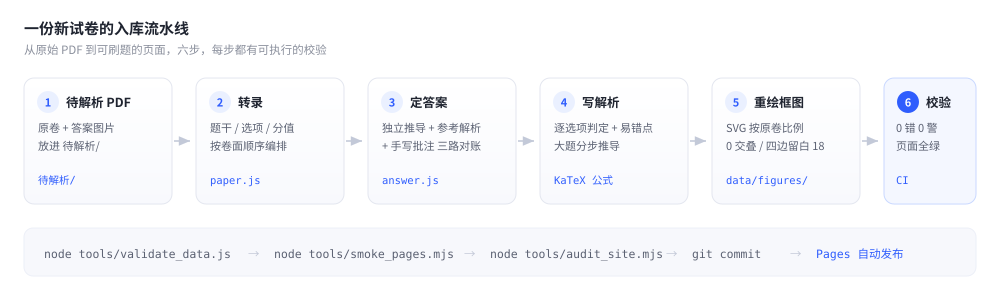
</p>

每年一个目录，两份数据文件：

```
data/questions/2025/
  paper.js    # 试卷元数据 + 分组 + 题干/选项（不含答案）
  answer.js   # 答案与解析，按题目 id 索引
data/figures/2025/
  2025-三-ssb.js        # 题目原图：一图一文件
  answer/2025-四-q4x.js  # 解析配图
```

好处是 diff 干净：改一道题只动几行，review 时看得见。坏处是 `app/index.html` 要逐个登记 `<script>` —— 这件事由 `app/scripts/sync-data.mjs` 负责同步到 `public/`，但清单本身仍是手写的（有意为之，避免新增文件被悄悄带上线）。

### 新增年份

把新年份的试卷与答案放进 `待解析/`，然后按 [`skills/bupt801/SKILL.md`](skills/bupt801/SKILL.md) 走：转录 → 定答案 → 写解析 → 画 SVG → 校验 → 页面实测 → 在 [`解析日志.md`](解析日志.md) 追加记录 → 提交。

一次入库就是**一个年份一个提交**，信息格式 `feat(2025): 入库 2025 真题（30 空 + 8 大题 + 11 图）`，CHANGELOG 由它自动生成。

## 目录结构

```
待解析/                    # 原始 PDF 与答案图片（输入，不参与网页构建）
data/
  chapters.js              # 两级章节 → 知识点体系（全站筛选维度）
  questions/<年>/          # 题库：paper.js + answer.js
  figures/<年>/            # SVG 图库：一图一文件 + answer/ 解析配图
app/                       # Vue 3 前端（Vite）
  public/donate/           # 微信 / 支付宝收款码
  src/styles/app.css       # 设计系统：浅/深色令牌 + 组件样式（改配色只动文件头令牌区）
  src/views/               # 8 个页面
  src/components/          # 题目卡、答题卡、解析、图块、放大弹窗、命令面板、笔记面板…
  src/lib/                 # 数据访问、记录、SRS、笔记、模考档案、计划、备份、搜索、渲染…
server/                    # Express：托管 app/dist + /api/pdf/<年>/(paper|ans) 在线排版
tools/                     # 校验、冒烟、全站审计、图件生成与收边
deploy/                    # nginx.conf + docker-compose.yml
docs/images/               # README 配图（真实截图 + 重绘 SVG + 示意图）
.github/workflows/         # CI / Pages 发布 / release-please / Release 附件
```

## 质量与验收

改完数据或前端，下面几条全绿才算完（CI 里也是这几条）：

```bash
node tools/validate_data.js         # 数据侧：题型/分值/答案/图件引用，要求 0 错误 0 警告
node tools/smoke_pages.mjs          # 页面侧：25 条路由 + 11 条交互流程（jsdom，无需浏览器）
node tools/audit_site.mjs           # 全站审计：逐年 × 3 页 + 全部功能页、21 条完整流程、a11y 扫描
node tools/check_figure_overlap.js 2025   # 图件：0 交叠、四边留白 18/18/18/18
```

`validate_data.js` 的数值不是「跑一遍看它不报错」，而是用**独立于解析的第二种方法**复核：GF(2) 高斯消元验证生成矩阵、穷举陪集验证伴随式译码、真跑一遍 Viterbi 比对幸存路径。同一个错误不会因为写了两遍就变成对的。

## 版本与发布

版本号由 [release-please](https://github.com/googleapis/release-please)（Google 官方）根据 [Conventional Commits](https://www.conventionalcommits.org/) 自动判定，流程全自动：

1. 往 `main` 提交 `feat(...)` / `fix(...)`；
2. release-please 开一个 **Release PR**（改 `CHANGELOG.md` 与版本号，你能看到它准备发什么）；
3. 合并这个 PR → 自动打 tag、建 GitHub Release；
4. 同一个 workflow 接着构建根路径版 `app/dist`，打成 `bupt801-web-<tag>.zip` 挂到 Release 附件（不能用独立的 `on: release` workflow：Release 由 `GITHUB_TOKEN` 创建，token 触发的事件不会再拉起新 workflow）。

所以你不用手动改版本号，也不用手写 CHANGELOG —— 但**提交信息要写对**：`feat` 升 minor，`fix` 升 patch，`feat!` 或 `BREAKING CHANGE` 升 major。

## 纠错与贡献

### 提纠错（最欢迎）

[**开一个 Issue**](https://github.com/ygxiuming/BUPT-801-Tiku/issues/new/choose)，选对应模板：

- **答案纠错** — 年份、题号、你的推导或出处
- **题干/图件错误** — 哪一年哪一题、错在哪、原卷长什么样（截图最好）
- **功能建议** — 想要什么、为什么现有流程不够用

每条都会认真回：

| 你提的 | 我做什么 |
|---|---|
| 答案不对 | 按你的推导和参考解析各算一遍，确认后改 `answer.js`，在解析里写明「为何与参考资料不同」 |
| 题干/选项抄错 | 对照原卷 PDF 逐字核，改完重跑全套校验 |
| 框图与原卷不符 | 按原卷比例重绘 SVG，过留白/交叠检查 |
| 想加新年份 | 见[新增年份](#新增年份)，或直接在 Issue 里给出原卷出处 |

提纠错时请尽量带上：**年份 + 题号 + 你的解法/依据**。只写「这题答案好像不对」我会来问一遍，多一轮往返；带上推导我就能直接定位。

### 提 PR

```bash
git checkout -b fix/2025-q30-answer
# 改数据 → 跑上面四条校验 → 提交
git commit -m "fix(2025): 修正第 30 题答案与解析"
git push origin fix/2025-q30-answer
```

PR 描述里请写清「改了什么、依据是什么、跑了哪几条校验」。只改数据不动格式的 PR 最好审。更多约定见 [CONTRIBUTING.md](CONTRIBUTING.md)。

### 答案可信度

每份答案都过了三道：**独立推导 ✓ 参考解析 ✓ 手写批注核对 ✓**。个别与参考资料不一致的地方（例如 2025 年第 30 题）按严格推导定论，并在解析里写明差异原因 —— 这类地方最容易有争议，欢迎直接来对线。

## 请作者喝杯咖啡

> **题库免费，咖啡自费。**

这个项目没有广告、没有登录、没有会员，也不会把你的做题记录传到任何服务器。代价是：每年的卷子要逐字转录、逐题推导、逐图重绘，外加跑校验、回 Issue、修 CI —— 基本都是我一个人下班后肝出来的。

如果它帮你省下了一个对答案的晚上，欢迎请我喝杯咖啡，让我有理由继续肝下一年。

<p align="center">
  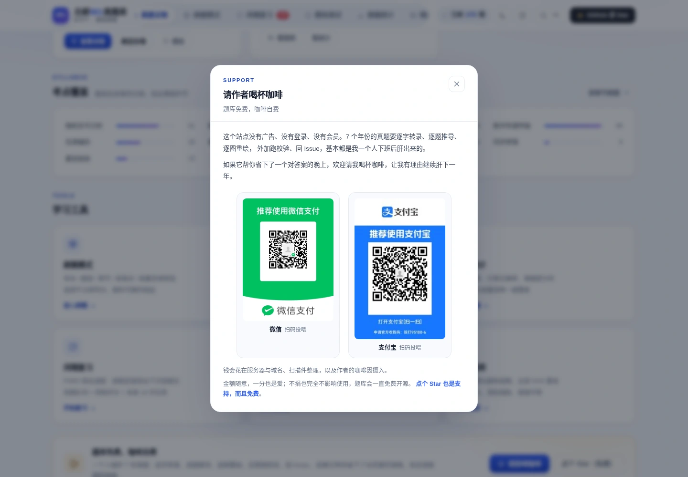
</p>
<p align="center"><sub>站点内入口：页脚「投喂作者」或首页底部「请我喝咖啡」</sub></p>

<table>
  <tr>
    <td align="center">
      <br>
      <b>微信</b>
    </td>
    <td align="center">
      <br>
      <b>支付宝</b>
    </td>
  </tr>
</table>

钱会花在服务器与域名、扫描件整理，以及作者的咖啡因摄入。金额随意，一分也是爱；**不捐也完全不影响使用**，题库会一直免费开源。

不想花钱？那就去 [GitHub 点个 Star](https://github.com/ygxiuming/BUPT-801-Tiku) —— 免费，而且对作者同样有效。

## 版权与免责

- **代码**（`app/`、`server/`、`tools/`、`.github/`）以 [Apache-2.0](./LICENSE) 开源。
- **真题原卷**版权归北京邮电大学所有；`待解析/` 下的扫描件来自公开渠道，仅用于个人复习与题目转录，**不得用于商业用途**。若权利人认为有不妥，请开 Issue 或邮件联系，会立即移除。
- **解析与重绘框图**是本项目原创内容，同样按 Apache-2.0 提供，欢迎纠错，不保证绝对正确。
- 收款码仅用于自愿支持项目维护，不构成任何课程、资料或录取承诺。
- 这个仓库与北京邮电大学官方**没有任何关系**，不提供任何录取、命题相关承诺。

---

<p align="center">
  <b>如果这份题库帮你省下了对答案的时间，欢迎点个 Star；有错误，更欢迎开个 Issue。</b><br>
  <a href="https://github.com/ygxiuming/BUPT-801-Tiku">github.com/ygxiuming/BUPT-801-Tiku</a>
</p>
